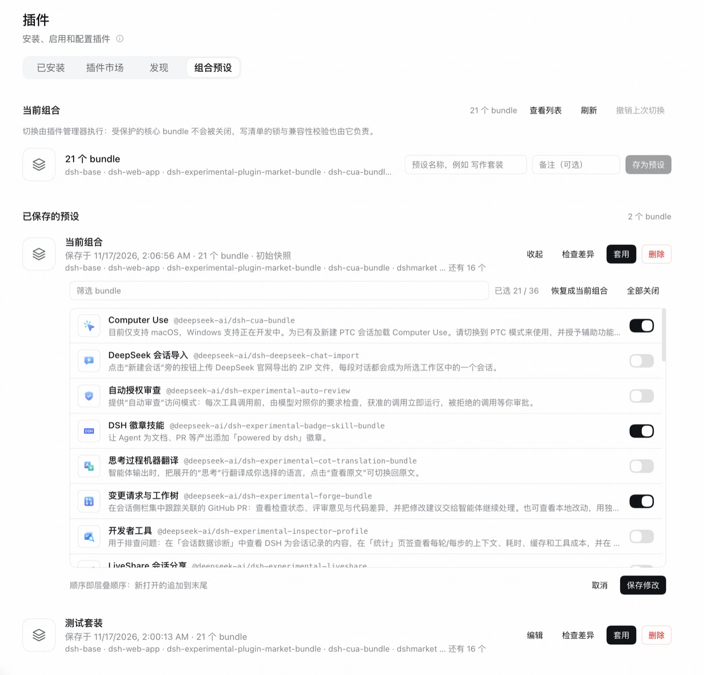

# dsh-bundle-presets

Named bundle-set presets for [DeepSeek Harness](https://github.com/deepseek-ai/deepseek-harness). Save the bundle list a profile is running as a named set, edit that set with the same switches the plugin list uses, apply it in one click, and undo the last switch.

[](https://www.npmjs.com/package/dsh-bundle-presets)
[](LICENSE)
[](https://github.com/ZY-WANG-0304/dsh-bundle-presets/actions/workflows/publish.yml)


中文说明见 [README.zh.md](README.zh.md)。

## Screenshot



## What it does

A **preset** is a named list of bundle package names from `dsh.profile.bundles`. The plugin adds a **Presets** tab to the Plugins page where you can:

- **Save** the current selection (what the profile is running right now, not a template).
- **Edit** a preset in place: every bundle in the profile is listed with its icon, localized title, package name, description and the native 36×20 switch.
- **Preview** the difference before applying: which bundles the preset would turn on or off.
- **Apply** it. Enables run first and disables second, so the browser bundle survives the transition.
- **Undo** the last switch; the snapshot is written only when the manifest actually changed.
- **Overwrite** an existing name only after an explicit confirmation (`409 name-exists` first).

The sidebar foot also carries a **Presets** row (just above Settings): hovering it opens a flyout on the right listing every preset with the active one marked, and one click switches to it. The flyout also offers **Undo last switch** and **Manage presets…**, which opens the Plugins page on its **Presets** tab; clicking the row pins the flyout, `Esc` closes it and returns focus to the row.

Switching goes through `pluginManager.setBundleEnabled()`, so it inherits the profile write lock, version-compatibility checks, HMR recomposition and the plugin manager's protected-bundle refusals. A switch is refused as a whole (`409 unappliable`, with per-bundle reasons) when any step could not run: a bundle whose files are missing or whose patch cannot be read, or a protected bundle that would have to be turned off. A step that already wrote the manifest and then failed to recompose is reverted immediately.

## Install

```sh
dsh plugin --profile <your-profile> add dsh-bundle-presets
```

Or, in the app: **Plugins → Add plugin** → search `dsh-bundle-presets`. Restart the profile if your host has HMR off. The plugin needs a Web surface (`web` or `desktop`); headless, SDK and ACP profiles do not mount it.

## Use

1. Set the composition you want from the **Installed** tab as usual.
2. Open **Plugins → Presets**, name the set, **Save preset**.
3. Later, pick the preset and press **Apply**. **Preview** shows the difference first; **Undo last switch** goes back one step.

The **Current set** card lists the active bundles in layer order (read-only); edit a preset to change what a set contains.

## Limits

- It switches the **bundle composition of one profile**. It does not switch profiles, sessions, settings or credentials.
- Presets store package names, not versions: after an upgrade or removal, missing entries are skipped and listed in the editor.
- The plugin manager appends newly enabled bundles, so an applied set can hold the same bundles in a different order; the "current" badge and the diff compare sets.
- Routes are `Host`-fenced to loopback, so a deployment reached through a reverse proxy or a LAN address gets 403; add your own authentication before exposing it.
- State lives in `<profile dir>/bundle-presets.json` and is guarded by a cross-process lock.

## Development

```sh
node tests/plan.test.mjs     # pure planning: diff, name rules, preflight refusals
node tests/routes.test.mjs   # real HTTP handlers with a stub plugin manager
```

Both run without touching a live profile.

## License

MIT © ZY-WANG-0304
