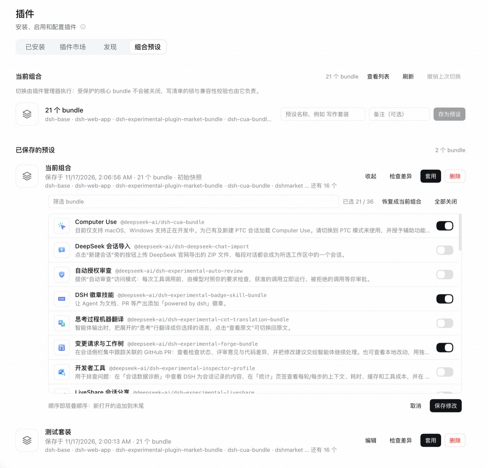

# dsh-bundle-presets · 插件组合预设

给 [DeepSeek Harness](https://github.com/deepseek-ai/deepseek-harness) 的命名 bundle 组合：把当前 profile 正在跑的 bundle 列表存成一套预设，用和原生插件列表一样的开关就地编辑，一键套用，也可以撤销上一次切换。

[](https://www.npmjs.com/package/dsh-bundle-presets)
[](LICENSE)
[](https://github.com/ZY-WANG-0304/dsh-bundle-presets/actions/workflows/publish.yml)


English: [README.md](README.md)

## 截图



## 它做什么

一套**预设**就是一组 bundle 包名（对应 `dsh.profile.bundles`）。插件在 Plugins 页新增 **组合预设** 标签：

- **存为预设**：记录此刻实际选中的组合（不是模板）。
- **就地编辑**：列出本 profile 能选的所有 bundle，带图标、本地化标题、包名、简介和原生 36×20 开关。
- **检查差异**：套用前先看会开启/关闭哪些。
- **套用**：先开后关，避免界面在切换途中掉掉。
- **撤销上次切换**：只有 manifest 真的变了才写快照。
- **同名保存要先确认**：先返回 `409 name-exists`，确认后才覆盖。

侧栏底部还有一行**插件组合预设**（在「设置」上方）：悬停即展开右侧浮出菜单，列出所有预设并标出当前这套，点一下直接切换，菜单底部还有「撤销上次切换」和「管理预设…」——后者会打开 Plugins 页并选中其中的 **组合预设** 标签；点击该行可把菜单钉住，`Esc` 关闭并回到该行。

切换走 `pluginManager.setBundleEnabled()`，因此继承了 profile 写锁、版本兼容性检查、HMR 重组，以及插件管理器对受保护 bundle 的拒绝。只要有一步做不成（文件缺失、patch 读不出来、要关受保护 bundle），整单拒绝并返回 `409 unappliable` 与逐项原因，**零写入**；某一步已写盘但重组失败时会立刻反向恢复。

## 安装

```sh
dsh plugin --profile <你的 profile> add dsh-bundle-presets
```

或在应用里 **插件 → 添加插件** 搜索 `dsh-bundle-presets`。宿主的 HMR 关闭时需要重启 profile。插件需要浏览器面（`web` / `desktop`），headless / SDK / ACP profile 不会挂载。

## 用法

1. 先在**已安装**标签把组合调成想要的样子。
2. 打开 **插件 → 组合预设**，起名，**存为预设**。
3. 之后选中预设点 **套用**；不确定就先点 **检查差异**；点 **撤销上次切换** 退回上一步。

**当前组合** 卡片按层叠顺序列出正在生效的 bundle（只读）；要改某套预设的内容，用它的 **编辑**。

## 边界

- 它切的是**一个 profile 的 bundle 组合**，不切 profile、会话、设置或凭据。
- 预设只存包名不存版本：升级/卸载后缺失项会被跳过并在编辑器里列出。
- 插件管理器是追加式启用，所以套用后的顺序可能与保存时不同；「当前」角标与差异按集合比较。
- 路由有 `Host` 回环围栏，反代或局域网地址访问会 403；要对外开放请自行加鉴权。
- 状态存在 `<profile 目录>/bundle-presets.json`，有跨进程文件锁。

## 开发

```sh
node tests/plan.test.mjs     # 纯函数：差集、名称规则、预检拒绝
node tests/routes.test.mjs   # 真 HTTP handler + stub 插件管理器
```

两个测试都不碰正在运行的 profile。

## License

MIT © ZY-WANG-0304
